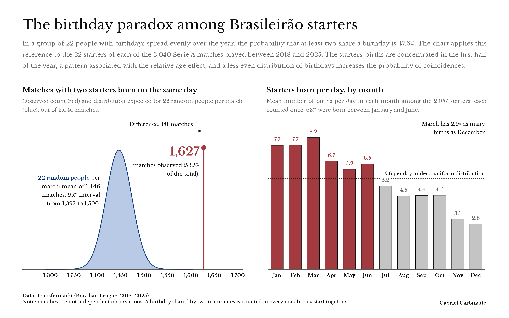

# The Birthday Paradox in the Brasileirão

## Summary

Collects from Transfermarkt the lineups of the eight Campeonato Brasileiro Série A seasons between 2018 and 2025, adds every starter's date of birth and compares how often two of the 22 starters share a birthday with what the birthday paradox predicts for 22 random people. The result is a single landscape chart (16:10), `viz/brasileirao_2018_2025_birthday_paradox.png`:

- **Matches with a shared birthday.** In 1,627 of the 3,040 matches (53.5%), two starters were born on the same day. With 22 random people in every match (all 365 days equally likely, 47.6% per match), the number would follow a binomial distribution: 1,446 on average, between 1,392 and 1,500 in 95% of cases. That is 181 more matches than random people would produce.
- **Births by month.** One outlined bar per month with the number of starters born per day in it, so that 28- and 31-day months compare directly; with even births, every bar would be 5.6. March has 8.2 a day and December 2.8: youth football groups players by birth year, which favours those born early (the relative age effect).



## Method

- **Matches.** A match is analysed when all 22 starters have a known date of birth: 3,040 of 3,040 matches, with 2,057 different starters.
- **Shared birthday.** Same day and month, regardless of year.
- **Uniform model.** `1 − ∏(365 − k)/365` for `k` from 0 to `n − 1`, the classic paradox. With random people, matches are independent, so the number of the 3,040 with a shared birthday is binomial with that probability.
- **Starters model.** Draws groups of different starters from the real birthdays of the 2,057 starters, each counted once. The chance that all birthdays differ is `n! · e_n(c) / (N (N − 1) ··· (N − n + 1))`, where `c` are the counts per day, `e_n` is the elementary symmetric polynomial of degree `n` and `N` is the number of starters; dynamic programming computes it exactly. Drawing without replacement matters: with replacement, the same player could appear twice and "share" a birthday with himself, which would raise the figure for 22 people from 50.4% to 55.7%.
- **Permutation.** Reshuffles the starters' birthdays among them 2,000 times, keeping the real lineups. Since the same players appear in many matches, this is the right reference to test the observed share. Its mean (50.4%) matches the starters model, and the observed 53.5% falls inside its 95% range (45.4% to 55.4%). The birth distribution explains part of the gap to the classic paradox; the rest is within the variation expected when the same teammates play many matches together.
- **Intervals.** The 95% Wilson interval of the observed share (51.7% to 55.3%) is descriptive, because matches are not independent.

## Structure

- `R/setup.R`: packages, folders, seasons and read/write helpers.
- `R/00-data_collection.R`: fixtures, lineups, dates of birth and clubs from the Transfermarkt API, with caching and an audit.
- `R/01-birthday_analysis.R`: shared birthdays per match, reference models, permutation and birth distribution.
- `R/02-poster.R`: the chart, with ggplot2, patchwork, ggtext for titles and marquee for justified text.
- `data/raw/transfermarkt-api/`: original API responses, one per request, not versioned.
- `data/processed/`: tables ready for analysis and for the chart.
- `assets/fonts/`: Libre Baskerville and Lato, with their OFL licences.
- `viz/`: final chart.

## Running

The scripts run from the project root, in order:

```bash
Rscript -e 'install.packages(c("dplyr", "ggplot2", "ggtext", "httr2", "jsonlite", "marquee", "patchwork", "purrr", "ragg", "readr", "scales", "stringr", "systemfonts", "tidyr"))'
Rscript R/00-data_collection.R
Rscript R/01-birthday_analysis.R
Rscript R/02-poster.R
```

The first collection makes about 3,100 requests, capped at 100 per minute, and takes around an hour. Later runs read the cache.

## Outputs

| file in `data/processed/`                    | content                                                    |
| -------------------------------------------- | ---------------------------------------------------------- |
| `brasileirao_2018_2025_matches.csv`          | one match per row, with date, clubs and score              |
| `brasileirao_2018_2025_lineups.csv`          | one player per match, starter or substitute                |
| `brasileirao_2018_2025_players.csv`          | players with their date of birth                           |
| `brasileirao_2018_2025_clubs.csv`            | participating clubs                                        |
| `brasileirao_2018_2025_collection_audit.csv` | collection coverage per season                             |
| `brasileirao_2018_2025_match_results.csv`    | shared birthdays in each analysed match                    |
| `brasileirao_2018_2025_shared_birthdays.csv` | every repeated birthday in a match, with the players       |
| `brasileirao_2018_2025_summary.csv`          | observed share, interval and the three references          |
| `brasileirao_2018_2025_birthday_curve.csv`   | uniform and starters probabilities for groups of 1 to 60   |
| `brasileirao_2018_2025_random_matches.csv`   | distribution of matches with a shared birthday, random people |
| `brasileirao_2018_2025_birth_months.csv`     | births per month against the expected share                |
| `brasileirao_2018_2025_birth_days.csv`       | starters born on each day of the year                      |
| `brasileirao_2018_2025_uniformity_tests.csv` | chi-square uniformity tests by day and by month            |
| `brasileirao_2018_2025_permutation.csv`      | simulated shares from the permutation                      |

## References

- McGregor, R. J. and Shannon, G. P. (2004). [On the generalised birthday problem](https://doi.org/10.1017/S0025557200174972).
- Berresford, G. C. (1980). [The uniformity assumption in the birthday problem](https://doi.org/10.1080/0025570X.1980.11976872).
- Fadnavis, S. (2011). [A generalization of the birthday problem and the chromatic polynomial](https://arxiv.org/abs/1105.0698).
- Rabelo, F. N. et al. (2016). [Efeito da idade relativa nas categorias do futebol brasileiro](https://doi.org/10.1016/j.rbce.2016.01.001).
- Bozděch, M., Agricola, A. and Zháněl, J. (2023). [The relative age effect at different age periods in soccer: a meta-analysis](https://doi.org/10.1177/00315125231210585).
